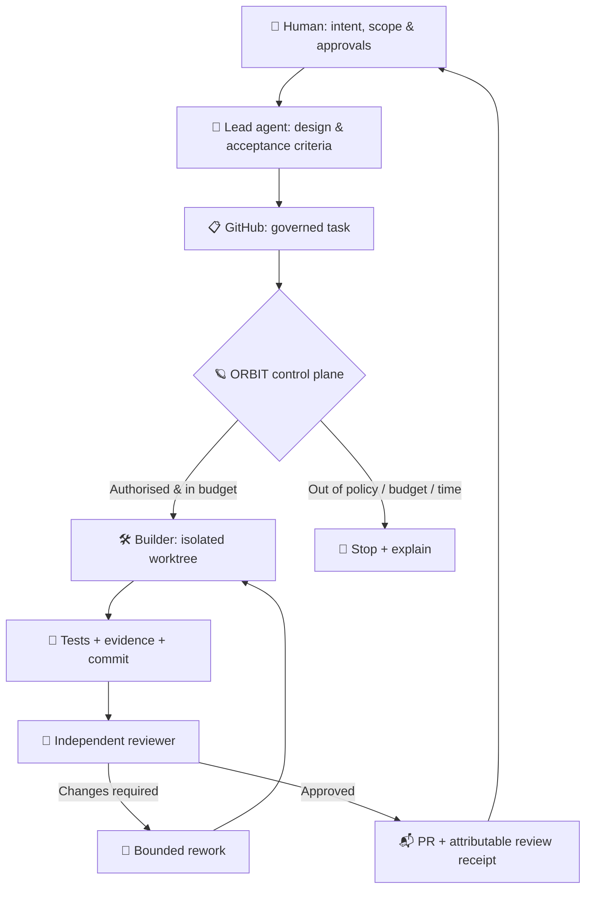

<div align="center">

# 🪐 ORBIT
### **Your AI development control plane.**

**Delegate the build. Verify the work. Stay in control.**

[](https://github.com/arbtraderlabs/orbit)
[](https://github.com/arbtraderlabs/orbit)
[](#the-principle)

*The next generation of agentic development isn't about making one AI do everything. It's about getting several agents to work together—with evidence, independent review and clear boundaries.*

[Why ORBIT?](#the-problem) · [See the workflow](#how-it-works) · [Real-world scenarios](#where-orbit-shines) · [Roadmap](#roadmap) · [Get involved](#get-involved)

</div>

---

> [!IMPORTANT]
> **ORBIT is an early-stage, standalone project concept—not an installable, production-ready framework yet.** The diagrams, configuration and commands below describe the intended experience. They are not claims of implemented features. It grew out of lessons from a separately governed, single-worker CrashDash pilot.

## The problem

You've already written a solid specification with a capable AI. Now you hand the implementation to a smaller, cheaper local model.

It builds something. Tests look green. But did it **actually follow the design**?

So you copy diffs, terminal output and snippets into a stronger reviewer, paste the feedback back to the builder, and repeat. The lead agent loses context; the worker drifts; the developer becomes the clipboard.

**ORBIT is designed to remove the clipboard—not the human.**

| Today: the manual loop 😵 | ORBIT: the intended loop 🪐 |
| --- | --- |
| Copy code into a second AI chat | Reviewer reads the exact commit and evidence |
| Paste review findings into the builder | Review creates a bounded rework task |
| Ask “what changed?” repeatedly | Every attempt has a durable receipt |
| Manually track branches and partial runs | Isolated worktrees and recoverable jobs |
| Leave the desk = work stops | Schedule authorised jobs for peak or off-peak hours |
| Hope the small model followed the spec | Compare implementation against the original acceptance criteria |

## How it works



**The crucial part:** a worker's claim that it passed is *not* its own independent approval. ORBIT's proposed review lane checks the actual pinned change, expected behaviour and supporting evidence.

### Meet the crew

| Role | Mission | Example tools |
| --- | --- | --- |
| 🧠 **Lead** | Frames the task, architecture and acceptance boundary | ChatGPT, Claude, Codex |
| 🛠️ **Builder** | Implements code, fixes tests, creates evidence | OpenCode, Codex, Claude Code, local LLMs |
| 🔍 **Reviewer** | Checks the exact diff against the spec; finds drift and security risks | Separate model/agent |
| 🪐 **Controller** | Enforces task admission, queue, identity, budget and recovery | ORBIT (proposed) |
| 👤 **Operator** | Sets limits, authorises exceptional actions, decides what ships | You |

ORBIT is **not** intended to replace coding agents or MCP tools. It aims to orchestrate them.

## Where ORBIT shines

<details open>
<summary><strong>🎯 01 — “I wrote the spec. Did the cheap model follow it?”</strong></summary>

Give a capable lead agent the design. Delegate implementation to an affordable worker. Have a separate reviewer inspect pinned commits, tests and deviations. Escalate major design changes to the lead or human instead of silently changing scope.

**Outcome:** lower-cost implementation with higher-confidence verification—not blind trust in a passing test.

</details>

<details>
<summary><strong>🔬 02 — Long-running research without model drift</strong></summary>

Run sandbox experiments over multiple sessions. Preserve the hypothesis, cohort, acceptance criteria and evidence. Pause when a result contradicts the original design; ask for independent review before the next wave.

**Outcome:** reproducible research rather than an endlessly shifting conversation.

</details>

<details>
<summary><strong>🌙 03 — Let the lab work while you're away</strong></summary>

Schedule eligible tasks during preferred windows, such as off-peak hours. Set caps on jobs, spending, runtime and concurrency. Review the morning's receipts instead of babysitting a terminal.

**Outcome:** productive idle time without unrestricted autonomous execution.

</details>

<details>
<summary><strong>🧑‍💻 04 — A virtual engineering team for solo builders</strong></summary>

Separate implementation, test repair, code review and documentation. Each role gets its own boundary; parallel work uses isolated branches and worktrees.

**Outcome:** multiple specialised agents without multiple untracked conversations.

</details>

<details>
<summary><strong>🚨 05 — Interrupted job? Keep the evidence.</strong></summary>

A provider times out, a host reboots or an agent fails. ORBIT should preserve the original attempt, costs, receipts and predecessor chain. Any retry must be explicitly eligible—not a hidden replay.

**Outcome:** recovery that is understandable, auditable and safe.

</details>

<details>
<summary><strong>🛡️ 06 — Reviews that can actually say no</strong></summary>

Tests passing is one signal, not final acceptance. Independent reviewers may reject an unsafe permission change, missing test, unsupported claim or architecture drift. The work returns for bounded rework or escalates.

**Outcome:** trust grounded in inspectable evidence.

</details>

## A day in ORBIT *(illustrative future experience)*

```text
09:00  🧠 Lead defines Issue #42 with spec + acceptance criteria
09:01  🪐 ORBIT validates identity, scope and budget
09:02  🛠️ Builder starts in its own isolated worktree
09:18  🧪 Tests pass, commit and evidence recorded
09:20  🔍 Reviewer detects a missing failure-path test
09:21  🔁 Rework sent back with exact finding
09:30  ✅ Reviewer clears the corrected commit
09:31  📬 Draft PR and complete receipt delivered
09:32  👤 You decide whether to merge
```

No copy/paste relay. No invisible scope creep. No surprise deployment.

## The principle

```text
                         HUMAN INTENT
                              │
                   policy + acceptance
                              │
                   ┌──────────▼──────────┐
                   │   ORBIT CONTROLLER   │
                   │  queue · trust · cap │
                   └───┬──────────────┬───┘
                       │              │
                BUILD & TEST      VERIFY & CHALLENGE
                       │              │
                       └──────┬───────┘
                              │
                       REVIEWABLE PR
                              │
                       HUMAN DECISION
```

**Autonomy inside a boundary. Escalation at the boundary.**

- **Never** treat a GitHub label, issue-body edit or worker self-report as proof of authorisation.
- **Never** automatically expand repository access, spend limits or deployment permissions.
- **Always** bind approvals to exact tasks and reviewed evidence.
- **Always** preserve interrupted attempts, dirty worktrees and review history.
- **Default:** open a PR; do not auto-merge or deploy.
- **Review the review:** a separate model helps, but model disagreement and evidence gaps still need human judgment.

## Proposed product experience

A future guided setup would ask for **repository**, **agent CLI/model**, **task admission rule**, **autonomy level**, **workspace**, **budget/schedule**, and **GitHub reporting preferences**.

```yaml
# Illustrative only — no ORBIT CLI/config schema is implemented yet.
repository: owner/project
task_trigger: explicit_approval
workers:
  builder: { agent: opencode, max_concurrent: 1 }
  reviewer: { agent: codex, independent: true }
limits:
  jobs_per_day: 5
  max_concurrent: 1
  paid_models: false
schedule:
  mode: off_peak
delivery:
  pull_request: draft
  audit_receipt: github
  auto_merge: false
```

The intention: **configure the safe defaults once, then let properly authorised tasks move without endless manual handovers.**

## Architecture, not another coding agent

ORBIT aims to sit **above** existing AI development tools:

```text
 GitHub issues / pull requests / design specs
                    │
          ORBIT: policy + scheduler
                    │
             durable job queue
                    │
        ┌───────────┼───────────┐
        ▼           ▼           ▼
     Builder     Reviewer    Researcher
        │           │           │
        └───────────┼───────────┘
                    ▼
         Evidence + PR + receipts
```

An initial MVP could use a Python CLI, SQLite queue, one repository, one worker and one independent reviewer. Multi-host pools, plug-in adapters and advanced schedules come later, **after an end-to-end pilot proves the core workflow**.

## Roadmap

| Stage | Goal | Status |
| --- | --- | --- |
| 🌱 **00 — Define** | Public problem statement, architecture and example workflows | **Here now** |
| 🧪 **01 — Prove** | One GitHub task → local worker → tests → independent review → receipt | Planned |
| 🔒 **02 — Harden** | Authenticated authorisation, durable retries, budgets and STOP | Planned |
| 🌙 **03 — Schedule** | Operator-defined peak/off-peak execution windows | Planned |
| 👥 **04 — Scale** | Multiple worker roles and isolated concurrent workspaces | Future |
| 📦 **05 — Share** | Installer, setup wizard, provider adapters and documentation | Future |

*Development status is intentionally conservative. Prior CrashDash experiments are not an ORBIT release or a passed ORBIT integration test.*

## What ORBIT is (and isn't)

✅ An idea for **agent orchestration**, **independent AI code review**, **human-in-the-loop automation**, **GitHub-driven development** and **local/low-cost LLM workflows**.

❌ Not yet a downloadable tool, autonomous production deployer, guarantee of code correctness, or replacement for professional security review.

## Get involved

If you've ever copied a diff between AI chats, lost track of an autonomous agent's changes, or wished a stronger model could supervise a cheaper builder, this project is for you.

⭐ **Star** the repo to follow development.  
💬 **Open an issue** with a real-world workflow you want ORBIT to support.  
🧪 **Share a failure mode**—especially retries, drift, budgets or review handoffs.

**Suggested GitHub topics:** `ai-agents` · `agentic-ai` · `multi-agent` · `agent-orchestration` · `ai-code-review` · `developer-tools` · `github-automation` · `llm` · `local-llm` · `human-in-the-loop` · `devtools` · `autonomous-agents`

---

<div align="center">

### 🪐 ORBIT
**Build in parallel. Review independently. Ship deliberately.**

*Born from a simple question: why is the human still the clipboard between AI agents?*

</div>
